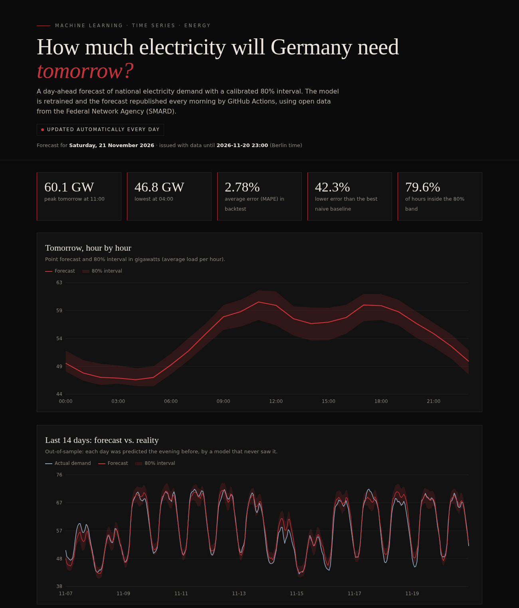

# ⚡ Germany Electricity Demand: Day-Ahead Forecast

**Live dashboard → https://sonu2002.github.io/germany-energy-forecast/**

[](https://github.com/sonu2002/germany-energy-forecast/actions/workflows/daily-forecast.yml)
[](https://github.com/sonu2002/germany-energy-forecast/actions/workflows/tests.yml)


How much electricity will Germany need tomorrow, hour by hour? This project forecasts national electricity demand
(grid load) for the next day with a **calibrated 80% uncertainty band**. It retrains and republishes every morning,
fully automated with **GitHub Actions**, using open data from the Federal Network Agency (Bundesnetzagentur / SMARD).



## Results (out-of-sample backtest)

Trained on Jan 2023 – Jun 2025, tested on **12,193 hours (Jul 2025 – Nov 2026)** the model never saw:

| Model | MAPE | MAE |
|---|---|---|
| **Gradient boosting (this project)** | **2.78%** | **1,469 MW** |
| Naive: same hour last week | 4.82% | 2,545 MW |
| Naive: same hour yesterday | 7.40% | 3,847 MW |

* **42% lower error** than the best naive baseline.
* **80% interval covers 79.6%** of real values (well calibrated, via split-conformal prediction).
* Hardest hour: 14:00 (rooftop solar makes midday grid load harder to predict); easiest: 07:00.

The numbers above are from the first run. The live dashboard always shows the latest backtest.

## How it works

```
SMARD API ──► src/download.py ──► data/smard_hourly.csv (load, price, solar, wind; hourly since 2023)
                                         │
                                         ▼
                      src/features.py: calendar, German holidays (Easter computed), lags 24h/48h/7d/14d,
                                       yesterday's mean/min/max, last week's mean
                                         │
                                         ▼
                      src/pipeline.py: backtest vs. naive baselines → conformal 80% band
                                       → refit on all data → forecast tomorrow
                                         │
                                         ▼
               reports/metrics.json + docs/data/dashboard.json ──► GitHub Pages dashboard (docs/index.html)
```

* **No data leakage:** the forecast is issued at midnight after day D for all 24 hours of day D+1. Every feature only
  uses data up to the end of day D. `tests/test_features.py` proves it by changing the forecast day's data and checking
  that the features do not move.
* **Honest baselines:** a model is only useful if it beats "same hour last week".
* **Uncertainty:** hour-specific quantiles of out-of-sample errors from a calibration window (split-conformal), not
  the over-confident in-sample spread.
* **Automation:** `.github/workflows/daily-forecast.yml` runs every morning: download → tests → backtest → forecast → commit.
  The dashboard is a static page (hand-written SVG charts, no frameworks) that reads the JSON.

## Run it yourself

```bash
pip install -r requirements.txt
python src/download.py     # first run downloads ~4 years of hourly data (takes a few minutes), later runs are incremental
python src/pipeline.py     # backtest + tomorrow's forecast
python -m pytest -q        # 5 tests: holidays, Easter, no-leakage, metrics
```

## Project structure

```
src/download.py      SMARD downloader (incremental, retries)
src/features.py      feature engineering + German public holidays
src/pipeline.py      backtest, conformal interval, live forecast, dashboard JSON
tests/               pytest unit tests
docs/                GitHub Pages dashboard + data/dashboard.json
reports/             metrics.json, backtest_hourly.csv
```

## Ideas for next steps

* Add weather (temperature, cloud cover) from Open-Meteo as features.
* Forecast the day-ahead **price** as well (data is already downloaded).
* Compare with the official TSO load forecast published on SMARD.

## Data & licence

Data: **Bundesnetzagentur | SMARD.de**, licence [CC BY 4.0](https://creativecommons.org/licenses/by/4.0/).
Code: MIT. Built by [Sonu Phogat](https://sonu2002.github.io) · [LinkedIn](https://www.linkedin.com/in/sonuphogat).
